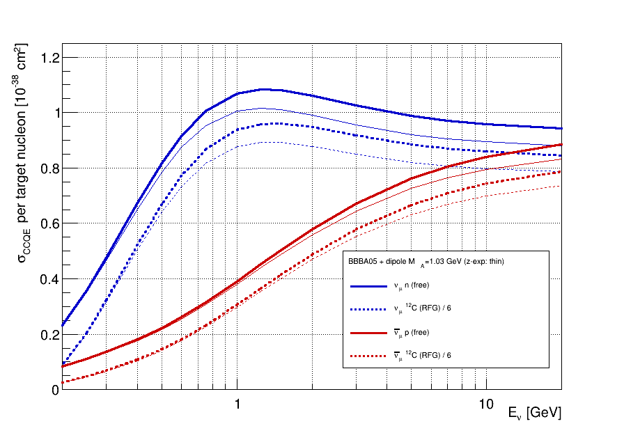
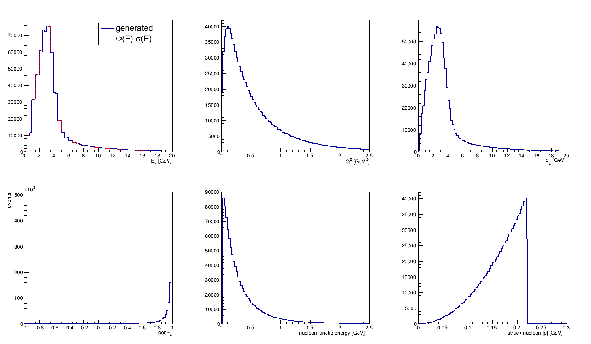

# Charged-current quasi-elastic scattering (CCQE)

This note covers the physics of the `nuflow` CCQE model and how it is implemented. The model spans three stages:

| Stage | Class | Role |
|---|---|---|
| 1 | `channel/CCQEChannel` | Which nucleons can be struck; channel multiplicity; process id 200 |
| 2 | `initial_state/RelativisticFermiGas`, `initial_state/FreeNucleon` | Struck-nucleon momentum and removal energy |
| 3 | `kinematics/QuasiElasticKinematics`, `kinematics/QECurrent`, `kinematics/FormFactors` | Lepton and nucleon kinematics, and the cross-section weight |

The processes are
$$
\nu_\ell + n \to \ell^- + p, \qquad \bar\nu_\ell + p \to \ell^+ + n ,
$$
on nucleons bound in a nucleus (or free, for hydrogen). The model is the standard "Llewellyn Smith + relativistic Fermi gas" baseline:
- the free-nucleon weak current of Llewellyn Smith [1];
- with modern vector form factors [7] and a choice of axial form factor [8, 9];
- embedded in the global relativistic Fermi gas of Smith and Moniz [2, 3], in the impulse approximation;
- with the de Forest prescription for the off-shell struck nucleon [5].

The building blocks are the same as those underlying the default QE models of GENIE, NEUT and NuWro. Spectral-function [6] and local-Fermi-gas [10] variants, used by ACHILLES, NuWro and GiBUU, are noted as upgrades in §8. Everything here was derived and implemented from the papers, not from generator source code.

---

## 1. Free-nucleon weak current

### 1.1 Matrix element

At GeV energies the charged-current interaction is a contact interaction:
$$
\mathcal{M} = \frac{G_F V_{ud}}{\sqrt 2}\; \ell_\mu\, J^\mu ,
\qquad
\ell_\mu = \bar u(k')\,\gamma_\mu(1-\gamma_5)\,u(k).
$$
For $\bar\nu$ the lepton current is $\bar v(k)\gamma_\mu(1-\gamma_5)v(k')$. Here $G_F = 1.1663788\times10^{-5}\ \text{GeV}^{-2}$ and $|V_{ud}| = 0.97367$.

Lorentz covariance, time-reversal invariance and the absence of second-class currents restrict the nucleon matrix element of the isovector $V-A$ current to four real form factors. This is Llewellyn Smith's Eq. (3.13) [1] with the second-class terms $F_V^3$ and $F_A^3$ set to zero:
$$
J^\mu = \bar u(p')\left[\gamma^\mu F_1(Q^2) + \frac{i\sigma^{\mu\nu}q_\nu}{2M}F_2(Q^2)
- \gamma^\mu\gamma_5 F_A(Q^2) - \frac{q^\mu}{M}\gamma_5 F_P(Q^2)\right]u(p),
\qquad q = p'-p .
\tag{1}
$$

**Sign convention.** We take $F_A(0)=+g_A>0$ with $g_A = 1.2723$. The explicit minus sign in front of the axial current then makes Eq. (1) the Standard-Model $V-A$ combination, $\bar u\gamma^\mu(1-\gamma_5)d \to \gamma^\mu F_1 - g_A\gamma^\mu\gamma_5+\dots$. This is fixed unambiguously by the brute-force trace test in §3.4, which requires this sign to reproduce the Llewellyn Smith result with constructive vector–axial interference for neutrinos. Llewellyn Smith [1] instead writes $+\gamma_\lambda\gamma_5F_A$ with $F_A(0)=-1.23$ (his Sec. 3.3), and Meyer *et al.* [8] use $g_A=-1.2723$. That is the same physics: all axial terms simply change sign together.

### 1.2 Vector form factors (CVC)

Under the conserved-vector-current hypothesis the weak vector form factors are the isovector electromagnetic ones, $G^V = G^p - G^n$:
$$
F_1 = \frac{G_E^V + \tau G_M^V}{1+\tau},\qquad
F_2 = \frac{G_M^V - G_E^V}{1+\tau},\qquad
\tau = \frac{Q^2}{4M^2},
\tag{2}
$$
where $M$ is the average nucleon mass. At $Q^2=0$: $F_1(0)=1$ and $F_2(0)=\mu_p-\mu_n-1 = 3.7059$. The "$\xi F_2$" of some references is our $F_2$.

The Sachs form factors are taken from **BBBA05** [7], the default. Each is a rational function of $\tau = Q^2/4M^2$, where $M$ is the nucleon mass (a single mass, as in [7]; we use the average $M=0.93892$ GeV). From Eq. (6) and Table 1 of [7]:
$$
G(Q^2) = \frac{\sum_{k=0}^{2} a_k \tau^k}{1+\sum_{k=1}^{4} b_k\tau^k}
$$

| | $a_0$ | $a_1$ | $a_2$ | $b_1$ | $b_2$ | $b_3$ | $b_4$ |
|---|---|---|---|---|---|---|---|
| $G_E^p$ | 1 | −0.0578 | – | 11.1 | 13.6 | 33.0 | – |
| $G_M^p/\mu_p$ | 1 | 0.150 | – | 11.1 | 19.6 | 7.54 | – |
| $G_E^n$ | 0 | 1.25 | 1.30 | −9.86 | 305 | −758 | 802 |
| $G_M^n/\mu_n$ | 1 | 1.81 | – | 14.1 | 20.7 | 68.7 | – |

The magnetic rows are normalized to $G_M(0)/\mu=1$, and the fit assumes $G_E^n>0$.

An alternative (`vector: dipole`) is the dipole $G_D=(1+Q^2/M_V^2)^{-2}$ with $M_V^2=0.71\ \text{GeV}^2$ for $G_E^p$, $G_M^p/\mu_p$ and $G_M^n/\mu_n$, together with the Galster form $G_E^n = -\mu_n\tau_n G_D/(1+5.6\tau_n)$.

### 1.3 Axial and pseudoscalar form factors

- **Dipole** (`axial: dipole`, the default): $F_A = g_A\,(1+Q^2/M_A^2)^{-2}$, with $M_A = 1.03$ GeV by default. This is close to the deuterium-bubble-chamber world average $M_A=1.014\pm0.014$ GeV quoted in [8].
- **z expansion** (`axial: zexp`) [8, 9]: $F_A = \sum_{k=0}^{k_\text{max}} a_k z^k$, where
$$
z = \frac{\sqrt{t_\text{cut}+Q^2}-\sqrt{t_\text{cut}-t_0}}{\sqrt{t_\text{cut}+Q^2}+\sqrt{t_\text{cut}-t_0}} .
$$
  - The free parameters are $a_1..a_{k_\text{max}-4}$ (`zexp_a`; their number sets $k_\text{max}$).
  - $a_0$ is fixed by $F_A(0)=g_A$.
  - The last four, $a_{k_\text{max}-3}..a_{k_\text{max}}$, follow from the four sum rules. Ref. [8] (Eq. 16) writes them with falling factorials, $\sum_{k\ge n} k(k-1)\cdots(k-n+1)\,a_k=0$ for $n=0..3$. These span the same constraints as $\sum_k k^n a_k=0$, which is how they are implemented. They make $F_A\sim Q^{-4}$ at large $Q^2$.
  - The $5\times5$ linear system is solved when the object is constructed (`ZExpansionAxialFormFactor`).
  - Two coefficient sets are documented; both use our $F_A(0)>0$ convention:

| set | source | $g_A$ | $t_\text{cut}$ [GeV²] | $t_0$ [GeV²] | $k_\text{max}$ | free $a_k$ |
|---|---|---|---|---|---|---|
| deuterium (code default) | Meyer *et al.* 2016 [8], Eq. 31 | 1.2723 | $9(0.14)^2$ | −0.28 | 8 | $a_{1..4}=(-2.30, 0.6, 3.8, -2.3)$ |
| **LQCD average (loop config since step 25)** | Meyer 2026 [14], Table I, Eqs. 53–55 | 1.2754 | $9(0.134)^2=0.161604$ | −0.50 | 6 | $a_{1,2}=(-1.70104640, 0.26324902)$ |

  - *Deuterium set.* The fit of [8] to the ANL, BNL, BEBC and FNAL deuterium bubble-chamber data. It reproduces the published form factor to better than 3% for $Q^2<1$ GeV² (`tests/test_formfactors.cc`). Individual high-order coefficients differ from the rounded published values, because the sum rules amplify the rounding of $a_1..a_4$.
  - *LQCD-average set* [14]. A fit to the form factor and its $Q^2$ derivatives from five lattice-QCD calculations with full error budgets: RQCD 2020 [15], Djukanovic *et al.* (Mainz) 2022 [16], NME 2022, PNDME 2024 and ETM 2024. Correlations between results on shared gauge ensembles are handled by covariance derating. $g_A$ is the PDG neutron-β-decay value, not the lattice one. No neutrino-scattering data enter this set: [14] also shows the MINERvA $\bar\nu p$ fit and a combined LQCD+MINERvA fit only as comparisons. Our solver reproduces the published $a_0, a_3..a_6 = (0.72115656, 1.53433681, 0.01061114, -1.49893610, 0.67062898)$ to $<2\times10^{-6}$ (test). The published covariance of $(a_1,a_2)$ is $\begin{pmatrix}0.00175929 & -0.00294651\\ -0.00294651 & 0.00807158\end{pmatrix}$ (Eq. 54). It gives a relative 1σ band of 0.6/1.2/2.2/3.3/4.0% at $Q^2$ = 0.1/0.5/1/2/3 GeV², and $r_A^2 = 0.369(30)$ fm². The data constrain $Q^2\lesssim1$ GeV²; above that, the shape follows from the sum rules.

  Ratio of the LQCD average to the deuterium dipole ($M_A$ = 1.03 GeV, $g_A$ = 1.2723) used before step 25:

| $Q^2$ [GeV²] | 0 | 0.1 | 0.25 | 0.5 | 1 | 1.5 | 2 | 3 |
|---|---|---|---|---|---|---|---|---|
| $F_A^\text{LQCD}/F_A^\text{dip}$ | 1.002 | 1.040(6) | 1.108(9) | 1.227(15) | 1.461(32) | 1.680(48) | 1.882(62) | 2.244(89) |

  The slower fall-off is the generic LQCD result [13, 14]: an equivalent dipole fit gives $M_A\approx1.21$ GeV, but it still does not reproduce the shape [14]. The same review [13] quotes a 30–40% increase of the free-nucleon QE cross section above 1 GeV. The tension with deuterium is unresolved. Ref. [14] reports that the MINERvA $\bar\nu$–hydrogen extraction is compatible with the LQCD average ($\Delta\chi^2\approx3.2$, 1 dof) and that both disagree with the deuterium fits. It suggests uncontrolled nuclear or normalization systematics in the deuterium analyses.
- **Pseudoscalar**, from PCAC with pion-pole dominance:
$$
F_P(Q^2) = \frac{2M^2}{m_\pi^2+Q^2}\,F_A(Q^2).
\tag{3}
$$

---

## 2. Llewellyn Smith cross section on a free nucleon at rest

Contracting Eq. (1) with the lepton current and integrating over the unobserved azimuth gives Llewellyn Smith's Eq. (3.18) [1], restated in [11]:
$$
\frac{d\sigma}{dQ^2} = \frac{G_F^2 V_{ud}^2 M^2}{8\pi E_\nu^2}
\left[A(Q^2) \pm B(Q^2)\frac{s-u}{M^2} + C(Q^2)\frac{(s-u)^2}{M^4}\right],
\qquad s-u = 4ME_\nu - Q^2 - m_\ell^2 ,
\tag{4}
$$
with $+$ for $\nu$ and $-$ for $\bar\nu$ in our conventions ($F_A>0$, $Q^2>0$). Ref. [1] prints "$A\mp B$" (upper sign for $\nu$), with $B$ written in terms of $q^2<0$ and its own sign conventions for $F_A$ and $\gamma_5$. The physical content is the same: constructive vector–axial interference for neutrinos. Our form is fixed independently by the explicit Dirac-trace evaluation of §3.4. The functions are
$$
\begin{aligned}
A &= \frac{m_\ell^2+Q^2}{M^2}\Big[(1+\tau)F_A^2 - (1-\tau)F_1^2 + \tau(1-\tau)F_2^2 + 4\tau F_1F_2 \\
&\qquad\qquad - \frac{m_\ell^2}{4M^2}\Big((F_1+F_2)^2 + (F_A+2F_P)^2 - \big(\tfrac{Q^2}{M^2}+4\big)F_P^2\Big)\Big],\\
B &= \frac{Q^2}{M^2}F_A(F_1+F_2),\qquad
C = \tfrac14\left(F_A^2 + F_1^2 + \tau F_2^2\right).
\end{aligned}
$$
Eq. (4) is implemented in `LlewellynSmithDSigmaDQ2` and serves as a reference. It assumes a nucleon at rest with $M_n=M_p=M$. Generation instead uses the general contraction of §3, which also holds for moving, bound nucleons.

---

## 3. General contraction for a moving nucleon

### 3.1 Tensors

The spin-summed squared amplitude factorizes as $\overline{|\mathcal{M}|^2} = \frac{G_F^2V_{ud}^2}{2}\cdot\frac12\,L_{\mu\nu}H^{\mu\nu}$, where the $\frac12$ averages over the initial nucleon spin. The neutrino has a single helicity, so there is no average over it. The lepton tensor is
$$
L^{\mu\nu} = \mathrm{Tr}\big[(\not{k}'+m_\ell)\gamma^\mu(1-\gamma_5)\not{k}\gamma^\nu(1-\gamma_5)\big]
= 8\big[k^\mu k'^\nu + k'^\mu k^\nu - g^{\mu\nu}\,k\!\cdot\! k'\big] + (\text{antisymmetric, } \propto i\epsilon^{\mu\nu\alpha\beta}k_\alpha k'_\beta),
$$
and for $\bar\nu$ the antisymmetric part changes sign.

For the hadron tensor, the Gordon identity $\bar u'\,i\sigma^{\mu\nu}q_\nu u/2M = \bar u'[\gamma^\mu - P^\mu/2M]u$ (with $P=p+p'$) rewrites the vertex as
$$
\Gamma^\mu = a\gamma^\mu + bP^\mu + c\,\gamma^\mu\gamma_5 + d\,q^\mu\gamma_5,\qquad
a = F_1+F_2,\ \ b = -\frac{F_2}{2M},\ \ c = -F_A,\ \ d = -\frac{F_P}{M}.
$$
Then $H^{\mu\nu}=\mathrm{Tr}[(\not{p}'+M)\Gamma^\mu(\not{p}+M)\bar\Gamma^\nu]$. Evaluating the traces term by term (only terms with an even number of $\gamma$'s survive, and the $\gamma_5$ terms with fewer than four $\gamma$'s vanish) gives
$$
\begin{aligned}
H^{\mu\nu} ={}& 4a^2\left[p'^\mu p^\nu + p^\mu p'^\nu - g^{\mu\nu}\tfrac{Q^2}{2}\right]
 + 4c^2\left[p'^\mu p^\nu + p^\mu p'^\nu - g^{\mu\nu}\left(2M^2+\tfrac{Q^2}{2}\right)\right]\\
&+ \left[8abM + 4b^2\left(2M^2+\tfrac{Q^2}{2}\right)\right]P^\mu P^\nu
 + \left[2Q^2d^2 - 8Mcd\right]q^\mu q^\nu
 + (\text{antisymmetric}, \propto i\,ac\,\epsilon^{\mu\nu\alpha\beta}q_\alpha p_\beta).
\end{aligned}
$$
This uses the on-shell relations $p\cdot p' = M^2+Q^2/2$ and $p^2=p'^2=M^2$. The $c$–$d$ and $d^2$ terms are proportional to $q^\mu q^\nu$, so for $q=k-k'$ they contribute only through $q_\mu L^{\mu\nu}\propto m_\ell^2$. The induced pseudoscalar is therefore a lepton-mass effect, as expected. This is exact for a free nucleon and approximate with the de Forest $\tilde q$ of §5.1.

### 3.2 Closed form of $L_{\mu\nu}H^{\mu\nu}$

Two helper contractions with the symmetric lepton tensor are needed. For a tensor $V^\mu W^\nu + W^\mu V^\nu - g^{\mu\nu}Y$:
$$
S(V,W,Y) = 16\left[(k'\!\cdot V)(k\!\cdot W) + (k'\!\cdot W)(k\!\cdot V) - (k\!\cdot k')(V\!\cdot W) + (k\!\cdot k')\,Y\right],
$$
and for $Z^\mu Z^\nu$:
$$
R(Z) = 8\left[2(k'\!\cdot Z)(k\!\cdot Z) - (k\!\cdot k')\,Z^2\right].
$$
In terms of these,
$$
\boxed{
\begin{aligned}
L_{\mu\nu}H^{\mu\nu} ={}& 4a^2 S\!\left(p',p,\tfrac{Q^2}{2}\right) + 4c^2 S\!\left(p',p,2M^2+\tfrac{Q^2}{2}\right)
+ \left[8abM + 4b^2\left(2M^2+\tfrac{Q^2}{2}\right)\right] R(P)\\
&+ \left[2Q^2 d^2 - 8Mcd\right] R(q)
\;+\; 128\,h\,(F_1+F_2)F_A\left[(k\!\cdot p)(k'\!\cdot q) - (k\!\cdot q)(k'\!\cdot p)\right]
\end{aligned}}
\tag{5}
$$
with $h=+1$ for $\nu$ and $h=-1$ for $\bar\nu$, and $c^2=F_A^2$, $cd = F_AF_P/M$, $d^2=F_P^2/M^2$. This is `ContractQE` in `kinematics/QECurrent.cc`. It costs a few dozen floating-point operations, and the form factors are evaluated once per trial.

**Vector–axial interference.** For a massless neutrino and an on-shell nucleon, $(k\cdot p)(k'\cdot q)-(k\cdot q)(k'\cdot p) = (k\cdot k')(k\cdot p + k'\cdot p) - m_\ell^2(k\cdot p) > 0$, so $h=+1$ gives the constructive interference responsible for $\sigma_\nu > \sigma_{\bar\nu}$. In the rest frame this term becomes the $\pm B$ term of Eq. (4).

### 3.3 Reduction to Llewellyn Smith

For a nucleon at rest with $p'=k+p-k'$, two-body kinematics give
$$
\frac{d\sigma}{dQ^2} = \frac{\overline{|\mathcal M|^2}}{64\pi M^2E_\nu^2}
= \frac{G_F^2V_{ud}^2\,L_{\mu\nu}H^{\mu\nu}}{256\,\pi M^2E_\nu^2}.
$$
Substituting Eq. (5) reproduces Eq. (4) identically, for both $\nu$ and $\bar\nu$ and for arbitrary form-factor values. Numerically the two agree to $10^{-12}$ (`tests/test_qe_current.cc`).

### 3.4 Independent check with explicit Dirac matrices

Signs of $\epsilon$ tensors and $\gamma_5$ are notoriously convention-dependent, so Eq. (5) is also checked against a brute-force evaluation, `tests/DiracAlgebra.h`:
- $4\times4$ complex gamma matrices in the Dirac representation are built explicitly;
- the vertex is formed from Eq. (1) with the explicit $\sigma^{\mu\nu}$, without the Gordon identity;
- $\bar\Gamma = \gamma^0\Gamma^\dagger\gamma^0$ is formed numerically;
- both traces are computed by matrix multiplication and contracted with the metric.

For 50 random off-shell kinematic configurations and random form factors, Eq. (5) agrees with the brute-force result to $10^{-10}$ for both helicities. Together with §3.3 this fixes every sign: the Standard-Model current Eq. (1), Eq. (5) and Llewellyn Smith's Eq. (4) are mutually consistent.

---

## 4. Nuclear model: relativistic Fermi gas (stage 2)

### 4.1 Smith–Moniz global Fermi gas

`RelativisticFermiGas` follows the relativistic Fermi gas of Smith and Moniz [2]. It is the relativistic generalization of the Fermi-gas model that Moniz *et al.* [3] fitted to quasi-elastic electron scattering; the original 1971 analysis was non-relativistic, with an "average interaction energy" $\bar\epsilon$. The nucleus is a degenerate gas of free nucleons in a constant binding potential:
- **Momentum distribution:** uniform inside the Fermi sphere, $n(\mathbf p) = \frac{3}{4\pi k_F^3}\,\theta(k_F-|\mathbf p|)$. It is sampled as $|\mathbf p| = k_F\,u^{1/3}$ with an isotropic direction.
- **Energy:** the struck nucleon is on the mass shell less a constant binding (removal) energy,
$$
E = \sqrt{\mathbf p^2+M^2} - \epsilon_b .
$$
- **Pauli blocking:** the outgoing nucleon must lie above the Fermi surface of its own species, $|\mathbf p'|>k_F$. Otherwise the trial weight is set to zero.
- **Remnant:** the spectator system receives $P_A - \tilde p$, where $P_A=(M_A,\mathbf 0)$ and $\tilde p=(E,\mathbf p)$. It therefore carries momentum $-\mathbf p$ and the excitation energy implied by $\epsilon_b$, and four-momentum is conserved exactly in every event (checked in `tests/test_generator.cc`).

The parameters are per nucleus and per species, in `data/nuclei/nuclei.yaml`:

| Nucleus | $k_F$ [GeV] | $\epsilon_b$ [GeV] |
|---|---|---|
| $^{12}$C | 0.221 | 0.025 |
| $^{16}$O | 0.225 | 0.027 |
| $^{40}$Ar | p 0.242 / n 0.259 | 0.0295 |
| $^{40}$Ca | 0.251 | 0.028 |
| $^{56}$Fe | p 0.251 / n 0.263 | 0.036 |
| $^{208}$Pb | p 0.245 / n 0.283 | 0.044 |

The $^{12}$C and $^{40}$Ca values are those of Table I of Moniz *et al.* [3], from 500 MeV, 60° $(e,e')$ data with uncertainties of about ±5 MeV/$c$ on $k_F$ and ±3 MeV on $\bar\epsilon$. That table gives C 221/25, Ca 251/28, Ni 260/36 and Pb 265/44 MeV. For $^{208}$Pb, separate proton and neutron Fermi momenta are used whose average reproduces 265 MeV; the scaling $k_F^{p,n}=k_F(2Z/A, 2N/A)^{1/3}$ of [4] gives similar values. The remaining entries are interpolations in common use in neutrino generators.

**Hydrogen** is described by `FreeNucleon`: the proton is at rest, with no binding and no Pauli blocking. A channel uses it automatically for any $A=1$ target.

### 4.2 Optional high-momentum tail

Short-range nucleon–nucleon correlations populate momenta above $k_F$. Bodek and Ritchie [4] (their Eq. 6) based their momentum distribution on nuclear-matter correlation calculations:
$$
|\phi(p)|^2 = \frac{1}{c}\times\begin{cases}
1-6\left(\dfrac{k_Fa}{\pi}\right)^2 & p<k_F\\[2mm]
2R\left(\dfrac{k_Fa}{\pi}\right)^2\left(\dfrac{k_F}{p}\right)^4 & k_F<p<4\ \text{GeV}
\end{cases}
\qquad c=\tfrac43\pi k_F^3,\ a = 2\ \text{GeV}^{-1},\ R=\frac{1}{1-k_F/4\,\text{GeV}} .
$$
Integrating the tail gives exactly the fraction $f = 6(k_Fa/\pi)^2$ of nucleons above $k_F$: 11.9% for carbon.

`nuclear_model: {type: RFG, tail: bodek_ritchie}` implements this exactly:
- With probability $f$, $k$ is drawn from $k^2|\phi|^2\propto k^{-2}$ on $[k_F, 4\ \text{GeV}]$ by inverse CDF.
- Otherwise it is drawn uniformly in the Fermi sphere.

A generic tail with free `tail_fraction` and `tail_cutoff` is also available. The default is no tail, i.e. the pure Smith–Moniz gas. With the Bodek–Ritchie tail, the MINERvA LE flux-averaged CCQE cross section on CH drops by 2% (5.31 vs 5.42 ×10⁻³⁸ cm²). The acceptance falls from 0.51 to 0.30, because rare high-momentum nucleons set the weight envelope.

---

## 5. Cross section in the impulse approximation (stage 3)

### 5.1 Off-shell nucleon and the de Forest prescription

In the impulse approximation the neutrino scatters incoherently on one bound nucleon of four-momentum $\tilde p = (E, \mathbf p)$, with $E=\sqrt{\mathbf p^2+M^2}-\epsilon_b$. Energy–momentum conservation uses this off-shell momentum:
$$
k + \tilde p = k' + p' .
$$
The free current of Eq. (1), however, is defined for on-shell spinors. Following de Forest's "cc1" prescription [5], the hadron tensor is evaluated with:
- the on-shell initial momentum $\bar p = (\sqrt{\mathbf p^2+M^2},\mathbf p)$;
- the effective momentum transfer $\tilde q = p' - \bar p$, i.e. $\tilde\omega = E_{p'} - \bar E_p$, which is smaller than $\omega = E_\nu - E_\ell$ by $\epsilon_b$;
- form factors at $\tilde Q^2=-\tilde q^2$.

The lepton tensor uses the true $k$ and $k'$. This is the same $\tilde q$ that Benhar *et al.* use with spectral functions [6, Eqs. 15–16]: $\tilde\omega = \omega - E + M - \bar E_p$, where $E$ is the removal energy, which for the Fermi gas reduces to $\tilde\omega = \omega-\epsilon_b$. In Eq. (5) the substitution is $p\to\bar p$, $q\to\tilde q$ and $P\to p'+\bar p$.

The prescription breaks current conservation at order $\epsilon_b$. In electron scattering this is often repaired by eliminating $J^3$ through $q_\mu J^\mu=0$. We do not, because the axial current is not conserved anyway. The effect is part of the model uncertainty.

### 5.2 Phase space and flux factor

For a target nucleon moving through a neutrino flux, the interaction rate per nucleon defines the cross section [6]:
$$
d\sigma = \frac{\overline{|\mathcal M|^2}}{4E_\nu \bar E_p}\, d\Phi_2,\qquad
d\Phi_2 = (2\pi)^4\delta^4(k+\tilde p-k'-p')\frac{d^3k'}{(2\pi)^32E_\ell}\frac{d^3p'}{(2\pi)^32E_{p'}}
= \frac{|\mathbf k'^*|}{16\pi^2\sqrt s}\,d\Omega^* .
\tag{6}
$$
Here $s=(k+\tilde p)^2$, and starred quantities are in the rest frame of $k+\tilde p$ (the "ν–N CM frame"). The factor $1/(4E_\nu\bar E_p)$ carries the on-shell spinor normalization, equivalent to the $M/\bar E_p$ factor of the spectral-function literature. In the CM frame:
$$
E_\ell^* = \frac{s+m_\ell^2-M'^2}{2\sqrt s},\qquad |\mathbf k'^*|=\sqrt{E_\ell^{*2}-m_\ell^2}.
$$
The fully differential cross section is therefore
$$
\frac{d\sigma}{d\Omega^*} = \frac{G_F^2V_{ud}^2}{4}\;L_{\mu\nu}H^{\mu\nu}(k,k',\bar p,p')\;
\frac{|\mathbf k'^*|}{4E_\nu \bar E_p\,16\pi^2\sqrt s}\;\theta(|\mathbf p'|-k_F)\,\theta(\tilde\omega)\,\theta(\tilde Q^2).
\tag{7}
$$
It is zero if $\sqrt s < m_\ell + M'$. Exact masses are used throughout: $M_n$ for $n\to p$ initial states, $M_p$ for final protons, and the average $M$ only inside the current, Eqs. (2)–(5).

### 5.3 Sampling the lepton angle

With $\tilde p$ fixed, the only free variables are the CM lepton angles $(\theta^*,\phi^*)$, with $\theta^*$ measured from the neutrino direction in that frame. Since $k\cdot k'$ is linear in $\cos\theta^*$,
$$
Q^2 = -m_\ell^2 + 2|\mathbf k^*|\left(E_\ell^* - |\mathbf k'^*|\cos\theta^*\right) = Q^2_\text{min} + 2|\mathbf k^*||\mathbf k'^*|\,x,\qquad x = 1-\cos\theta^* .
$$
The cross section falls with $Q^2$ roughly like a dipole. Sampling $\cos\theta^*$ uniformly would waste most trials at high energy, where $Q^2_\text{max}\gg 1$ GeV². Instead $x\in[0,2]$ is drawn from the proposal
$$
g(x) = \frac{b}{\kappa\,(1+bx)^2},\qquad b = \frac{2|\mathbf k^*||\mathbf k'^*|}{\Lambda^2},\qquad \kappa=\frac{2b}{1+2b},
$$
by inverse CDF, $x = \big[(1-u\kappa)^{-1}-1\big]/b$. This is $\propto(1+Q^2/\Lambda^2)^{-2}$ in $Q^2$. The default is $\Lambda^2 = 0.6$ GeV² (`proposal_q2_scale`).

The proposal is heavier-tailed than the cross section, which falls like $(1+Q^2/M_A^2)^{-4}$ times polynomials, so the weight stays bounded. The angle $\phi^*$ is uniform. The trial weight returned to the framework is
$$
w = \frac{2\pi}{g(x)}\,\frac{d\sigma}{d\Omega^*}\quad[10^{-38}\ \text{cm}^2\ \text{per struck nucleon}],
$$
and its expectation over the stage-2 distribution is the cross section per target neutron (for $\nu$) or proton (for $\bar\nu$). The lepton is boosted back to the lab, and $p' = k+\tilde p-k'$.

### 5.4 Stage 1: channel definition

`CCQEChannel` acts on:
- **neutrons** for neutrinos, with multiplicity $m = N$;
- **protons** for antineutrinos, with multiplicity $m = Z$.

The per-nucleus cross section is $\sigma_A = m\,\langle w\rangle$, tabulated as described in [framework.md](framework.md). Two consequences:
- A neutrino on hydrogen has no CCQE channel. In a CH target all $\nu_\mu$ CCQE events are therefore on carbon.
- For $\bar\nu_\mu$, the hydrogen fraction is set by $\sigma_{\bar\nu p}^\text{free}$ against $6\,\sigma_{\bar\nu p}^{\text{C}}$.

---

## 6. Generation performance

| Quantity | Value |
|---|---|
| Time per stage-2+3 trial | ≈ 0.19 µs (one thread) |
| Acceptance (trials → events, including the 1.2 safety factor) | 0.44–0.55 for $E_\nu$ = 0.5–50 GeV; 0.51 for the MINERvA LE flux |
| Envelope violations | 0 in all test runs; largest $w/w_\text{env}\approx0.83$ against the 1.2 safety factor |
| Events/s without I/O | 1.3×10⁶ (1 thread), 6.6×10⁶ (16 threads) |
| 1M MINERvA LE events to ROOT | 3.6–4.6 s generation (writer-limited, machine load dependent), 6–7 s wall including the σ-table build |

The proposal of §5.3 keeps the efficiency nearly independent of energy, where a uniform $\cos\theta^*$ proposal would fall as $1/E_\nu$.

---

## 7. Validation

All numbers below can be reproduced with `build/nuflow-qe-table` and `build/nuflow-tests`.

### 7.1 Matrix element

| Test | Result |
|---|---|
| Eq. (5) vs explicit Dirac traces, 50 random configurations, $\nu$ and $\bar\nu$ | agreement < $10^{-10}$ |
| Eq. (5) at rest vs Llewellyn Smith Eq. (4) | agreement < $10^{-10}$ |
| $F_1(0)$, $F_2(0)$, $F_A(0)$, $F_P(0)$ | 1, 3.7059, $g_A$, $2M^2g_A/m_\pi^2$ |

### 7.2 Phase space and normalization: free nucleon

The table below gives, per struck nucleon in units of $10^{-38}$ cm², for BBBA05 and a dipole with $M_A=1.03$ GeV:
- the Monte Carlo total cross section on a free nucleon (Eq. 7 integrated by the generator's own sampling, 10⁶ trials);
- the Simpson integral of Eq. (4) over the allowed $Q^2$ range;
- the RFG carbon cross section per neutron (proton), and its ratio to the free value.

| $E_\nu$ [GeV] | $\nu n$ LS | $\nu n$ MC | $\nu$ C/n (RFG) | C/free | $\bar\nu p$ LS | $\bar\nu p$ MC | $\bar\nu$ C/p (RFG) | C/free |
|---|---|---|---|---|---|---|---|---|
| 0.2 | 0.2320 | 0.2327 | 0.0875 | 0.376 | 0.0850 | 0.0839 | 0.0255 | 0.304 |
| 0.3 | 0.4756 | 0.4756 | 0.3229 | 0.679 | 0.1381 | 0.1371 | 0.0688 | 0.502 |
| 0.5 | 0.8186 | 0.8175 | 0.6702 | 0.820 | 0.2233 | 0.2221 | 0.1458 | 0.656 |
| 0.75 | 1.0087 | 1.0061 | 0.8670 | 0.862 | 0.3151 | 0.3142 | 0.2328 | 0.741 |
| 1.0 | 1.0724 | 1.0688 | 0.9374 | 0.877 | 0.3914 | 0.3904 | 0.3060 | 0.784 |
| 1.5 | 1.0851 | 1.0811 | 0.9594 | 0.887 | 0.5033 | 0.5026 | 0.4145 | 0.825 |
| 2.0 | 1.0662 | 1.0614 | 0.9466 | 0.892 | 0.5787 | 0.5779 | 0.4884 | 0.845 |
| 3.0 | 1.0308 | 1.0257 | 0.9179 | 0.895 | 0.6718 | 0.6708 | 0.5788 | 0.863 |
| 5.0 | 0.9935 | 0.9884 | 0.8848 | 0.895 | 0.7622 | 0.7620 | 0.6661 | 0.874 |
| 10 | 0.9625 | 0.9572 | 0.8590 | 0.897 | 0.8412 | 0.8408 | 0.7440 | 0.885 |
| 20 | 0.9468 | 0.9416 | 0.8446 | 0.897 | 0.8847 | 0.8844 | 0.7858 | 0.889 |

The free-nucleon Monte Carlo agrees with Llewellyn Smith to within 0.6% above 0.25 GeV. Near threshold the difference grows to 1.3% ($\bar\nu p$ at 0.2 GeV, where the final neutron is 1.3 MeV heavier). The residual difference comes entirely from the neutron–proton mass splitting: the generator uses the physical masses, while Eq. (4) uses their average. Rebuilding with $M_n=M_p$ makes the two agree to ≤ 0.1% at every energy from 0.2 to 20 GeV, consistent with the Monte Carlo statistics of 10⁶ trials. This validates the CM-frame phase space, the Jacobian of the proposal, the flux factor and the unit conversion.

With the z-expansion axial form factor, the free-nucleon cross sections agree with the values quoted by Meyer *et al.* [8, Eq. 38] for the same form factor:

| | nuflow (z exp.) | Ref. [8] |
|---|---|---|
| $\sigma(\nu_\mu n)$, 1 GeV | 10.05 | 10.1 ± 0.9 |
| $\sigma(\nu_\mu n)$, 3 GeV | 9.55 | 9.6 ± 0.9 |
| $\sigma(\bar\nu_\mu p)$, 1 GeV | 3.81 | 3.83 ± 0.23 |

All values in units of $10^{-39}$ cm².

**LQCD-average axial form factor (step 25).** The same machinery with the set of Meyer 2026 [14] (`apps/nuflow-qe-table`, BBBA05, 2×10⁵ trials). Free-nucleon Llewellyn Smith cross sections [$10^{-38}$ cm²]:

| $E_\nu$ [GeV] | 0.5 | 1 | 2 | 3 | 5 | 10 | 20 |
|---|---|---|---|---|---|---|---|
| $\nu n$, dipole 1.03 | 0.819 | 1.072 | 1.066 | 1.031 | 0.994 | 0.963 | 0.947 |
| $\nu n$, LQCD | 0.903 | 1.281 | 1.346 | 1.322 | 1.284 | 1.247 | 1.228 |
| $\bar\nu p$, dipole 1.03 | 0.223 | 0.391 | 0.579 | 0.672 | 0.762 | 0.841 | 0.885 |
| $\bar\nu p$, LQCD | 0.241 | 0.432 | 0.669 | 0.799 | 0.933 | 1.058 | 1.129 |

LQCD/dipole is 1.10 at 0.5 GeV, 1.19 at 1 GeV and 1.28–1.30 above 3 GeV for $\nu n$. For $\bar\nu p$ it is 1.08, 1.10, 1.19 and 1.26–1.28. This is the 30–40% enhancement quoted in [13]. It is **not** compatible with the deuterium bubble-chamber cross sections (ANL, BNL, FNAL, BEBC), which lie around 0.9–1.0 above 2 GeV. Those data are what the dipole $M_A\approx1.0$ GeV and the deuterium $z$ expansion were fitted to: the deuterium $z$ set gives 0.96 at 3 GeV. The LQCD set overshoots them by ≈ 30%, and we keep it in the loop model knowingly. Refs. [13, 14] attribute the tension to deuterium-analysis systematics, and the $\bar\nu$–hydrogen data agree with LQCD.

On carbon with the spectral function ([spectral_function.md](spectral_function.md)), $\sigma_\text{CCQE}$ per neutron [$10^{-38}$ cm²] (`nuflow-xsec`, no FSI):

| $E_\nu$ [GeV] | 1 | 3 | 6 | 10 |
|---|---|---|---|---|
| SF, dipole 1.03 | 0.764 | 0.777 | 0.747 | 0.734 |
| SF, LQCD | 0.929 | 1.023 | 0.994 | 0.980 |

NOMAD measured $0.92\pm0.02\pm0.06$ per neutron on a carbon-dominated target at 3–100 GeV [17], and $0.81\pm0.05\pm0.08$ per proton for $\bar\nu$. The SF+LQCD value is within 1σ of it. The SF+dipole value is 2.9σ below. NOMAD's efficiency correction itself relied on an RFG nuclear model, so the comparison is indicative. Flux-averaged over the MINERvA ME FHC flux on CH, the CCQE cross section rises from 4.500 to 5.973 ×10⁻³⁸ cm² per CH (+33%). The total CC cross section rises from 49.70 to 51.17 (+3.0%), i.e. 3.82 → 3.94 ×10⁻³⁸ cm² per nucleon.

### 7.3 Nuclear effects



In the RFG, carbon is suppressed relative to free nucleons:
- by Pauli blocking at low $Q^2$, which dominates below ~1 GeV;
- by the reduced phase space from $\epsilon_b$, which shifts the threshold.

The ratio approaches ≈0.90 per neutron (0.89 per proton) at high energy; there the remaining suppression is the Pauli-blocked low-$Q^2$ region. For $\bar\nu$ the suppression is stronger at every energy, because the $\bar\nu$ cross section is weighted to lower $Q^2$. The struck-nucleon momentum distribution of generated events reproduces $\langle k^2\rangle = \frac35 k_F^2$ and the sharp cut at $k_F$ (`tests/test_nuclear.cc`).

### 7.4 MINERvA LE flux on CH (1M events)

`config/minerva_le_fhc_numu_CH.yaml`: the MINERvA LE FHC $\nu_\mu$ flux (2016 release), a CH target, BBBA05 with a dipole $M_A = 1.03$ GeV, RFG, and no FSI.

| | $\nu_\mu$ (1M events) | $\bar\nu_\mu$ FHC wrong-sign (100k) |
|---|---|---|
| $\langle\sigma\rangle_\Phi$ per CH [$10^{-38}$ cm²] | 5.421 | 4.335 |
| per nucleon ($/13$) | 0.4170 | 0.3335 |
| events on H | 0 | 16.1 % |
| $\langle E_\nu\rangle$, $\langle Q^2\rangle$ | 3.84 GeV, 0.545 GeV² | 6.89 GeV, 0.445 GeV² |
| $\max\lvert\sum p_\text{in}-\sum p_\text{out}\rvert$ | $1.4\times10^{-14}$ GeV | $1.4\times10^{-14}$ GeV |
| $E_\nu$ spectrum vs $\Phi\sigma$ | $\chi^2$/ndf = 77.6/80 | 82.6/80 |
| acceptance; envelope violations (max $w/w_\text{env}$) | 0.505; 0 (0.835) | 0.393; 0 (0.833) |



The panels show $E_\nu$ with $\Phi(E)\sigma(E)$ overlaid, $Q^2$, $p_\mu$, $\cos\theta_\mu$, the nucleon kinetic energy and the struck-nucleon momentum. They are produced by `scripts/validate.C`.

---

## 8. Limitations and planned extensions

- **Nuclear model:** the global Fermi gas has no correlation between momentum and removal energy and a sharp Fermi surface. Two upgrades now exist behind the `NuclearModel` interface:
  - the 12C **spectral function** with SRC pairs ([spectral_function.md](spectral_function.md)), used by the loop configuration since step 17;
  - the **local Fermi gas** [10] ([local_fermi_gas.md](local_fermi_gas.md)).
- **Long-range correlations:** the Valencia RPA [10] is available as `rpa: true` ([local_fermi_gas.md](local_fermi_gas.md) §4); it is off by default.
- **Coulomb corrections** to the outgoing charged lepton are not included. They matter at low energy and for heavy nuclei.
- **Off-shell ambiguity:** the de Forest prescription is one of several choices. The current is not conserved at order $\epsilon_b$, and the hadron-tensor contraction, Eq. (5), uses the average nucleon mass. Both are sub-percent effects at GeV energies.
- **Axial form factor:** the loop uses the LQCD average [14] (§1.3). It is constrained for $Q^2\lesssim1$ GeV². Above that, its shape follows from the four sum rules ($F_A/F_A^\text{dip}$ = 2.2 at 3 GeV², with a quoted 4% band that does not include the truncation choice $k_\text{max}$). The kmax = 7 and sampled-method variants of [14] differ by up to ±4% at 2–3 GeV². The resonance (HNV background, $M_A$ = 1.05) and MEC channels keep their own dipole axial form factors. The free-nucleon cross section is ≈ 30% above the deuterium data (§7.2).
- **Second-class currents and isospin breaking** are neglected, with $G_E^V$ and $G_M^V$ from isospin symmetry.
- **Multinucleon (2p2h/MEC)** is the separate `CCMEC` channel ([mec.md](mec.md)), relativistic MEC in the same RFG; NN-correlation (1p1h–2p2h interference) terms are not included. Single-pion production in the Δ region is the separate `CCRES` channel ([pion_production.md](pion_production.md)), and inelastic scattering above $W=1.6$ GeV is `CCDIS` ([dis.md](dis.md)).
- **FSI** is applied by the cascade ([fsi_cascade.md](fsi_cascade.md)). With `RFG` the cascade's local density and local $k_F$ and the vertex's global RFG ($k_F$ = 0.221 GeV, $\epsilon_b$ = 25 MeV) are consistent only on average. With `SF` or `LFG` the vertex position, local Pauli blocking and the cascade use the same density.

---

## 9. Configuration reference

```yaml
channels:
  - type: CCQE
    nuclear_model:
      type: RFG                 # relativistic Fermi gas (parameters from data/nuclei/nuclei.yaml);
                                # SF: spectral_function.md, LFG: local_fermi_gas.md
      tail: none                # or: bodek_ritchie (fraction 6 (kF a/pi)^2, 1/k^4 up to 4 GeV)
      tail_fraction: 0.0        # generic 1/k^4 tail fraction (ignored with tail: bodek_ritchie)
      tail_cutoff: 0.5          # generic tail cutoff [GeV]
    form_factors:
      vector: BBBA05            # or: dipole (with MV2, default 0.71 GeV^2) + Galster G_En
      axial: dipole             # or: zexp
      MA: 1.03                  # [GeV], dipole only
      gA: 1.2723                # loop config (LQCD set): 1.2754
      zexp_a: [-2.30, 0.6, 3.8, -2.3]   # free a1..a_{kmax-4}, zexp only (F_A(0) > 0 convention); kmax = len + 4
                                        # LQCD average (Meyer 2026): [-1.70104640, 0.26324902]
      tcut: 0.1764              # 9 m_pi^2 [GeV^2], zexp only; LQCD set: 0.161604
      t0: -0.28                 # [GeV^2], zexp only; LQCD set: -0.50
    rpa: false                  # Valencia RPA (local_fermi_gas.md section 4)
    proposal_q2_scale: 0.6      # Lambda^2 of the angular proposal [GeV^2]; affects efficiency only
```

---

## References

1. C. H. Llewellyn Smith, "Neutrino reactions at accelerator energies", *Phys. Rep.* **3**, 261 (1972); preprint SLAC-PUB-958. Sec. 3.3, Eqs. (3.13)–(3.22).
2. R. A. Smith and E. J. Moniz, "Neutrino reactions on nuclear targets", *Nucl. Phys. B* **43**, 605 (1972); erratum *ibid.* **101**, 547 (1975).
3. E. J. Moniz, I. Sick, R. R. Whitney, J. R. Ficenec, R. D. Kephart and W. P. Trower, "Nuclear Fermi momenta from quasielastic electron scattering", *Phys. Rev. Lett.* **26**, 445 (1971).
4. A. Bodek and J. L. Ritchie, "Fermi-motion effects in deep-inelastic lepton scattering from nuclear targets", *Phys. Rev. D* **23**, 1070 (1981); preprint FERMILAB-PUB-80-120-E. Eqs. (6)–(8).
5. T. de Forest Jr., "Off-shell electron-nucleon cross sections: the impulse approximation", *Nucl. Phys. A* **392**, 232 (1983).
6. O. Benhar, N. Farina, H. Nakamura, M. Sakuda and R. Seki, "Electron- and neutrino-nucleus scattering in the impulse approximation regime", *Phys. Rev. D* **72**, 053005 (2005), [hep-ph/0506116](https://arxiv.org/abs/hep-ph/0506116). Spectral functions: O. Benhar, A. Fabrocini, S. Fantoni and I. Sick, *Nucl. Phys. A* **579**, 493 (1994).
7. R. Bradford, A. Bodek, H. Budd and J. Arrington, "A new parameterization of the nucleon elastic form factors", *Nucl. Phys. B Proc. Suppl.* **159**, 127 (2006), [hep-ex/0602017](https://arxiv.org/abs/hep-ex/0602017).
8. A. S. Meyer, M. Betancourt, R. Gran and R. J. Hill, "Deuterium target data for precision neutrino-nucleus cross sections", *Phys. Rev. D* **93**, 113015 (2016), [arXiv:1603.03048](https://arxiv.org/abs/1603.03048).
9. B. Bhattacharya, R. J. Hill and G. Paz, "Model-independent determination of the axial mass parameter in quasielastic neutrino-nucleon scattering", *Phys. Rev. D* **84**, 073006 (2011), [arXiv:1108.0423](https://arxiv.org/abs/1108.0423).
10. J. Nieves, J. E. Amaro and M. Valverde, "Inclusive quasielastic charged-current neutrino-nucleus reactions", *Phys. Rev. C* **70**, 055503 (2004), [nucl-th/0408005](https://arxiv.org/abs/nucl-th/0408005).
11. J. A. Formaggio and G. P. Zeller, "From eV to EeV: Neutrino cross sections across energy scales", *Rev. Mod. Phys.* **84**, 1307 (2012), [arXiv:1305.7513](https://arxiv.org/abs/1305.7513).
12. L. Aliaga *et al.* (MINERvA), "Neutrino flux predictions for the NuMI beam", *Phys. Rev. D* **94**, 092005 (2016), [arXiv:1607.00704](https://arxiv.org/abs/1607.00704).
13. A. S. Meyer, A. Walker-Loud and C. Wilkinson, "Status of lattice QCD determination of nucleon form factors and their relevance for the few-GeV neutrino program", *Ann. Rev. Nucl. Part. Sci.* **72**, 205 (2022), [arXiv:2201.01839](https://arxiv.org/abs/2201.01839).
14. A. S. Meyer, "The nucleon axial form factor from averaging lattice QCD results", [arXiv:2601.02676](https://arxiv.org/abs/2601.02676) (2026). Table I, Eqs. (53)–(56), Fig. 13.
15. G. S. Bali *et al.* (RQCD), "Nucleon axial structure from lattice QCD", *JHEP* **05**, 126 (2020), [arXiv:1911.13150](https://arxiv.org/abs/1911.13150).
16. D. Djukanovic, G. von Hippel, J. Koponen, H. B. Meyer, K. Ottnad, T. Schulz and H. Wittig, "The isovector axial form factor of the nucleon from lattice QCD", *Phys. Rev. D* **106**, 074503 (2022), [arXiv:2207.03440](https://arxiv.org/abs/2207.03440).
17. NOMAD Collaboration, V. Lyubushkin *et al.*, "A study of quasi-elastic muon neutrino and antineutrino scattering in the NOMAD experiment", *Eur. Phys. J. C* **63**, 355 (2009), [arXiv:0812.4543](https://arxiv.org/abs/0812.4543).
